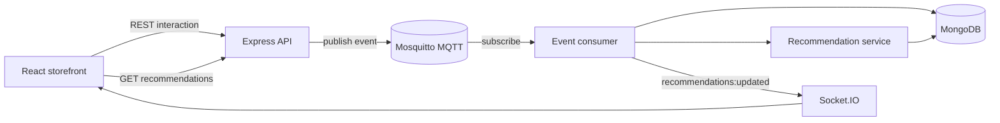

# Pulse — Real-Time Product Recommendation Platform

A portfolio-ready full-stack recommendation demo built with **MongoDB, Express, React, Node.js and MQTT**. Shopper interactions are published to an MQTT topic, consumed asynchronously by the API, persisted in MongoDB, and used to refresh personalized recommendations. The React dashboard receives refreshed results over Socket.IO.

> This is an educational/portfolio implementation. The included recommender is an explainable weighted-content + popularity baseline, not a production-grade machine-learning model. The simulator generates synthetic traffic; it does not represent real customers.

## Features

- Product catalog with category filtering and search.
- 200 synthetic shopper profiles created by the seed script.
- Interaction tracking: `view`, `click`, `wishlist`, `cart`, `purchase`.
- MQTT publish/subscribe pipeline with QoS 1 and event IDs for idempotent persistence.
- Recency-weighted category/tag preference scoring plus a popularity prior.
- Socket.IO push updates when a shopper's recommendations are recomputed.
- Synthetic event simulator for load/demo traffic.
- Docker Compose for MongoDB and Mosquitto.

## Architecture



**Event lifecycle:** user action → `POST /api/interactions` → MQTT `interactions/events` → consumer persists event → recommendation scores recalculated → Socket.IO emits `recommendations:updated` → selected user's React view updates.

## Tech stack

| Layer | Technology |
|---|---|
| Frontend | React 18, Vite, Lucide, Socket.IO Client |
| API | Node.js, Express |
| Database | MongoDB, Mongoose |
| Event streaming | MQTT 5 client + Eclipse Mosquitto |
| Live UI updates | Socket.IO |
| Local infrastructure | Docker Compose |

## Prerequisites

- Node.js 20+ and npm
- Docker Engine + Docker Compose plugin (or local MongoDB and Mosquitto installations)
- Git

## Run locally

### 1. Start MongoDB and MQTT

```bash
git clone https://github.com/<your-username>/real-time-product-recommendation-platform.git
cd real-time-product-recommendation-platform
docker compose up -d
```

### 2. Configure the API

```bash
cp .env.example .env
npm install
npm install --prefix server
npm install --prefix client
```

The defaults in `.env.example` work with the provided Docker Compose setup. On Windows PowerShell, use `Copy-Item .env.example .env` instead of `cp`.

### 3. Seed products and 200 demo users

```bash
npm run seed
```

### 4. Start the app

In the repository root:

```bash
npm run dev
```

- Frontend: http://localhost:5173
- API: http://localhost:5000/api
- Health: http://localhost:5000/api/health

### 5. Generate simulated real-time activity

Open another terminal in the repository root:

```bash
npm run simulate -- 1000
```

The simulator publishes 1,000 synthetic interaction events through MQTT. You can pass a different count, e.g. `npm run simulate -- 5000`.

## API reference

| Method | Endpoint | Description |
|---|---|---|
| GET | `/api/health` | Service health check |
| GET | `/api/products` | List available products |
| GET | `/api/products/:id` | Get one product |
| GET | `/api/users` | List demo shopper profiles |
| POST | `/api/users` | Create a shopper |
| POST | `/api/interactions` | Publish an interaction event to MQTT |
| GET | `/api/interactions/:userId` | Latest 50 interactions for a shopper |
| GET | `/api/recommendations/:userId?limit=8` | Get personalized recommendations |

Example interaction request:

```bash
curl -X POST http://localhost:5000/api/interactions \
  -H 'Content-Type: application/json' \
  -d '{"userId":"<mongo-user-id>","productId":"<mongo-product-id>","eventType":"cart"}'
```

The endpoint returns `202 Accepted` because processing is asynchronous. The event consumer writes it and pushes the refreshed recommendation list to the browser.

## Recommendation logic

For a shopper, the service reads up to 100 recent interactions and assigns event weights:

| Event | Weight |
|---|---:|
| View | 1 |
| Click | 2 |
| Wishlist | 3 |
| Cart | 4 |
| Purchase | 5 |

Each event is decayed by age using an exponential recency factor. Weighted signals are accumulated for product categories and tags. Candidate products receive a score from category affinity, tag affinity, a small 30-day popularity prior, and a novelty bonus. Purchased products are excluded. The implementation is intentionally transparent so it can be explained in an interview and extended later.

## Project structure

```text
real-time-product-recommendation-platform/
├── client/
│   ├── src/
│   │   ├── components/ProductCard.jsx
│   │   ├── services/api.js
│   │   ├── App.jsx
│   │   ├── main.jsx
│   │   └── styles.css
│   └── package.json
├── server/
│   ├── scripts/seed.js
│   ├── scripts/simulate.js
│   ├── src/
│   │   ├── config/db.js
│   │   ├── models/{Interaction,Product,User}.js
│   │   ├── routes/
│   │   ├── services/{mqtt,recommender}.js
│   │   └── index.js
│   └── package.json
├── infra/mosquitto.conf
├── docker-compose.yml
├── .env.example
└── README.md
```

## Deployment notes

- **Frontend:** deploy `client` to Vercel or Netlify. Set `VITE_API_URL` to your deployed API's `/api` URL.
- **API + MQTT:** deploy the Node API and Mosquitto on a VM/container host that supports persistent TCP connections. Set `MONGODB_URI`, `MQTT_URL`, `MQTT_TOPIC`, `CLIENT_ORIGIN`, and `PORT` in the host environment.
- **Database:** use MongoDB Atlas and set `MONGODB_URI` to its connection string.
- Do not expose an anonymous MQTT broker publicly. Configure authentication, TLS, topic ACLs and network restrictions before production use.
- Add authentication/authorization, rate limiting, schema validation, structured logging, metrics, dead-letter handling and retention policies before accepting real users.

## Important limitations and next improvements

1. The sample app uses a demo shopper selector instead of authentication.
2. MQTT is configured for local development with anonymous access; secure it for deployment.
3. Recommendation scoring is a baseline. For a stronger recommender, add offline evaluation (Precision@K, Recall@K, NDCG@K), collaborative filtering, cold-start onboarding and A/B tests.
4. The `200+ profiles` claim means the seed script creates 200 synthetic profiles. Do not describe them as real users.
5. The `under 2 sec` target should be measured under a defined load test. This code pushes updates asynchronously but does not guarantee a sub-two-second SLA on every deployment.

## GitHub publishing checklist

```bash
git init
git add .
git commit -m "Build real-time product recommendation platform"
git branch -M main
git remote add origin https://github.com/<your-username>/real-time-product-recommendation-platform.git
git push -u origin main
```

Before publishing, verify `.env` is not staged, add screenshots/GIFs of the running UI, and replace the GitHub URL placeholder in this README.

## License

MIT — add a `LICENSE` file if you intend to publish this as an open-source project.
